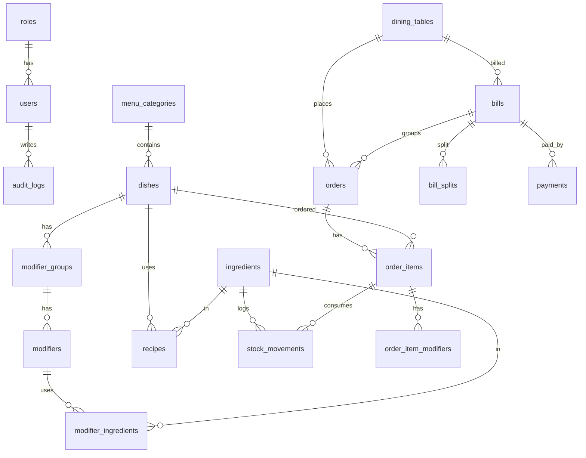

# Som Restaurant RTO: Som Restaurant RTO

Real-time ordering for restaurants in Somali cities. Customers order from a QR code at the table, waiters confirm, the kitchen cooks, the cashier bills. Payments and SMS are simulated. Runs on the restaurant's local network.
Built for the Somalia 10X Challenge, Project 14. Somali and English everywhere.

## Stack
React + Vite + Tailwind (client) · Node.js + Express (server) · MySQL/MariaDB with Knex (migrations, seeds) · Socket.IO (real-time) · JWT + bcrypt · Zod · Vitest + Supertest · GitHub Actions.

## Run it
1. Start MySQL (XAMPP) and create the database `restaurant_ordering_db` (utf8mb4_unicode_ci).
2. Server:
   ```
   cd server
   cp .env.example .env      # set DB_PASSWORD and a long random JWT_SECRET
   npm install
   npm run migrate
   npm run seed
   npm run dev               # http://localhost:5000
   ```
3. Client:
   ```
   cd client
   cp .env.example .env
   npm install
   npm run dev               # http://localhost:5173
   ```
4. Tests: `cd server && npm test` (CI runs the same on every push).

## Demo accounts
| Role | Username | Password |
|---|---|---|
| Manager | manager | Manager@123 |
| Cashier | cashier | Cashier@123 |
| Waiter | waiter1 / waiter2 | Waiter@123 |
| Kitchen | kitchen | Kitchen@123 |

Customers need no login: they scan the QR of their table (Manager > Tables and QR).

## Architecture
```
React screens  ->  Routes (HTTP + Zod validation)  ->  Services (business rules)  ->  Repositories (SQL only)  ->  MySQL
                                   Services -> realtime.js -> Socket.IO rooms (kitchen, waiters, table:<id>)
                                   Services -> adapters (payment gateway, SMS) : simulated, swappable
```
Screens never touch the database. Permissions are checked on the server on every request (`authenticate` + `authorize`).

## Main endpoints
| Area | Endpoints |
|---|---|
| Auth | `POST /api/auth/login`, `GET /api/auth/me` |
| Customer (QR) | `GET /api/public/menu`, `GET /api/public/table/:token`, `POST /api/public/orders` |
| Orders | `GET /api/orders/pending`, `POST /api/orders`, `POST /api/orders/:id/confirm`, `POST /api/orders/:id/reject` |
| Kitchen / items | `GET /api/kitchen/orders`, `PATCH /api/items/:id/status`, `POST /api/items/:id/cancel` |
| Bills | `POST /api/bills/table/:tableId`, `POST /api/bills/:id/splits`, `POST /api/bills/:id/payments` |
| Stock | `GET /api/stock/ingredients`, `POST /api/stock/movements` |
| Menu admin | `PATCH /api/menu-admin/dishes/:id`, `PUT /api/menu-admin/dishes/:id/recipe` |
| Reports | `GET /api/reports/summary?from&to` |
| Real-time events | `order:pending`, `order:confirmed`, `item:updated`, `item:ready`, `table:updated`, `menu:updated` |

## Data model (24 tables incl. Knex bookkeeping; 20 app tables)


## Core technical challenge
- **Stock deduction**: when the waiter confirms an order, ingredients (recipe + chosen modifiers) are deducted inside one DB transaction with `SELECT ... FOR UPDATE` row locks. Two orders competing for the last portion are processed one after the other: the second fails with 409 and nothing is written.
- **Auto-unavailable**: availability is computed from live stock every time the menu is read (scarcest ingredient decides), so a dish switches off on every screen when an ingredient runs out and returns when stock is added. Modifiers switch off the same way.
- **Under 1 second**: the order is pushed over Socket.IO right after the transaction commits.

## Assumptions and decisions
- Stock is deducted at waiter confirmation, not when the customer sends the order.
- The recipe is copied (snapshot) onto the order item when the order is created, so editing a recipe only affects future orders.
- Cancelled before cooking: stock is returned. Cancelled while cooking or ready: ingredients stay deducted and the movements are marked as waste.
- A waiter can only confirm, serve or bill tables assigned to them; other tables are view-only.
- A bill can be created only when no order is pending and every item is served. While a table has an open bill it refuses new orders.
- Splits: equally or by item; the amounts always add up to the total (rounding cents go to the last person). Partial payment is allowed on an unsplit bill. The table becomes Free only when the bill and every split are paid.
- Food cost % uses the dish recipe without modifiers and the current ingredient costs (a delivery with a unit cost updates it).
- Mobile money is simulated behind `adapters/paymentGateway.js` (a phone number ending in `0000` is declined); SMS is written to the `sms_outbox` table behind `adapters/smsGateway.js`.
- Not built: photo upload (dishes use an icon), moving an order to another table.

## Security
bcrypt password hashes · JWT with server-side role checks · Zod validation on all input · rate limiting (login, public orders, whole API) · `.env` not in Git (`.env.example` provided) · Knex parameterized queries · audit log of sensitive actions (login, order confirmation, cancellations, stock, payments, settings).

## Screenshots
(add: customer menu, waiter floor map, kitchen display, cashier bill and receipt, reports with charts, stock, language switch SO/EN, phone view)