# Som Restaurant RTO: Restaurant Real-Time Ordering

**The problem.** Busy restaurants in Somali cities take orders on paper. Orders get mixed up between tables, the kitchen does not know what to cook first, and owners do not know their real food cost per dish.

**The solution.** Customers order from a QR code at the table, the waiter confirms, the kitchen sees the order within a second, and the cashier bills and takes (simulated) cash or mobile money. Each dish has a recipe, so selling it deducts its ingredients from stock, and a dish switches off on every screen when an ingredient runs out. Runs on the restaurant's local network. Somali and English everywhere.

Built for the Somalia 10X Challenge, Project 14.

## Features

| # | Feature | Status | Notes |
|---|---|---|---|
| 1 | Menu (categories, dishes SO/EN, price, prep time, Available switch) | Done | Unavailable dishes stay visible, greyed out, "Not available now" |
| 2 | Modifiers (required / optional groups, price changes, ingredients) | Done | Modifier ingredients are deducted too |
| 3 | Table QR codes with a secret token, print, regenerate | Done | Regenerating disconnects phones that used the old QR |
| 4 | Table ordering from several phones, waiter confirmation, Closed table | Done | |
| 5 | Waiter screen: floor map by status, confirm, direct order, Ready alerts, move order | Done | |
| 6 | Kitchen display: oldest first, timer colours, sound, reload on reconnect | Done | |
| 7 | Item status Ordered → Cooking → Ready → Served, manager cancel with reason | Done | |
| 8 | Recipes with ingredient quantities, unit and cost | Done | Recipe snapshot per order item |
| 9 | Stock deduction, deliveries with cost, low-stock flag, movement log | Done | |
| 10 | Auto-unavailable (dishes and modifiers), manager override | Done | |
| 11 | Bills with service charge, split equally or by item | Done | |
| 12 | Simulated payment: cash with change, EVC Plus / Zaad / eDahab, receipt | Done | |
| 13 | Reports: daily sales, by dish and category, prep time, food cost % (> 40 % highlighted) | Done | |
| – | Dish photos | Partial | A photo URL can be set; there is no file upload |

Baseline: layered architecture, JWT login with 4 roles and server-side checks, audit log, MySQL with migrations and Somali seed data, 62 automated tests in CI, bcrypt, Zod validation, rate limiting, `.env.example`, charts from real queries, SO/EN switch, phone layout: all done.

## Tech stack

| Part | Technology (version) |
|---|---|
| Runtime | Node.js 22.15 |
| Server | Express 5.3, Socket.IO 4.8, Knex 3.3, mysql2 3.24, Zod 4.6, jsonwebtoken 9.0, bcryptjs 3.0, helmet 8.3, express-rate-limit 8.7 |
| Database | MySQL 8 / MariaDB 10.4+ (XAMPP works) |
| Client | React 19.3, Vite 8.3, Tailwind CSS 4.3, React Router 7.18, i18next 26.7, Recharts 3.10, socket.io-client 4.8, qrcode.react 4.2 |
| Tests / CI | Vitest 5.1, Supertest 7.3, GitHub Actions |

## Architecture

```
React screens ──HTTP──> Routes (auth + role check + Zod validation)
                           └─> Services (business rules, transactions)
                                 └─> Repositories (SQL only, Knex) ──> MySQL
                                 └─> realtime.js ──> Socket.IO rooms: kitchen · waiters · table:<id>
                                 └─> adapters/ (paymentGateway, smsGateway) — simulated, swappable
```

- **Screens never touch the database.** Routes only parse input and call a service; services hold the rules; repositories hold the SQL.
- **Permissions are checked on the server** for every request (`authenticate` + `authorize(...roles)`), and again inside services for table ownership (a waiter can only edit their own tables).
- **Adapters**: `server/src/adapters/paymentGateway.js` (mock EVC Plus / Zaad / eDahab; a phone ending in `0000` is declined) and `smsGateway.js` (writes to the `sms_outbox` table).

Full endpoint reference (method, path, request, response, roles) and the real-time events: [docs/API.md](docs/API.md).

## Setup on a fresh computer

Requirements: Node.js 22+, MySQL or MariaDB running (for example XAMPP).

1. Create the database `restaurant_ordering_db` (collation `utf8mb4_unicode_ci`).
2. Server:
   ```bash
   cd server
   cp .env.example .env    # set DB_PASSWORD and a long random JWT_SECRET
   npm install
   npm run migrate         # create the tables
   npm run seed            # demo data: users, tables, menu, recipes, stock
   npm run dev             # http://localhost:5000
   ```
3. Client:
   ```bash
   cd client
   cp .env.example .env    # VITE_API_URL: see "Phones on the local network"
   npm install
   npm run dev             # http://localhost:5173 (also on the local network)
   ```
4. Log in with a demo account below.

### Phones on the local network (QR ordering)
1. Find this computer's local IP (`ipconfig` on Windows), for example `192.168.1.20`.
2. In `client/.env` set `VITE_API_URL=http://192.168.1.20:5000` and restart `npm run dev`.
3. Open the app at `http://192.168.1.20:5173`, go to Manager › Tables and QR, check that the app address is the IP (not `localhost`), and print the QR codes.
4. Phones on the same Wi-Fi scan the QR. The server accepts requests from `localhost`, `192.168.x.x` and `10.x.x.x` (see `server/src/origins.js`). Allow Node.js through the Windows firewall if phones cannot connect.

## Tests

```bash
cd server
npm test
```

One command: it creates a **separate** test database (`DB_NAME_TEST`, default `restaurant_ordering_db_test`), migrates and seeds it, then runs 62 tests. The demo database is never touched. The same command runs in GitHub Actions on every push, together with the client lint and build.

The tests cover the core challenge: an order reaches the kitchen socket within 1 second, selling 10 portions deducts the right amounts, modifier ingredients are deducted, a dish switches off when an ingredient runs out and returns after a delivery, two waiters competing for the last portion, all-or-nothing deduction. They also cover status rules, cancellation and waste, waiter table ownership, closed tables and fake tokens, bills, splits, cash change, partial and mobile-money payments, concurrent bill creation, QR regeneration, staff and menu management, and login and role checks.

## Demo accounts

| Role | Username | Password |
|---|---|---|
| Manager | manager | Manager@123 |
| Cashier | cashier | Cashier@123 |
| Waiter (tables 1–4) | waiter1 | Waiter@123 |
| Waiter (tables 5+) | waiter2 | Waiter@123 |
| Kitchen | kitchen | Kitchen@123 |

Customers need no login: they scan the QR of their table.

## Demo script
1. Phone: scan table 1's QR, choose *Bariis iyo hilib* with a meat choice, send.
2. Waiter (waiter1): the order appears instantly, confirm it. Kitchen: the card appears with a sound.
3. Kitchen: Cooking → Ready. Waiter gets the Ready alert → Served.
4. Cashier: create the bill, split it, pay one part in cash (change shown) and one with EVC Plus (SMS in the outbox), show the receipt. The table becomes Free.
5. Manager › Stock: lower an ingredient, order until it runs out, and the dish greys out on every screen. Record a delivery and it comes back.
6. Manager › Reports: daily sales and food cost %.

## Data model

20 application tables. Migrations in `server/migrations`, seed data in `server/seeds`.

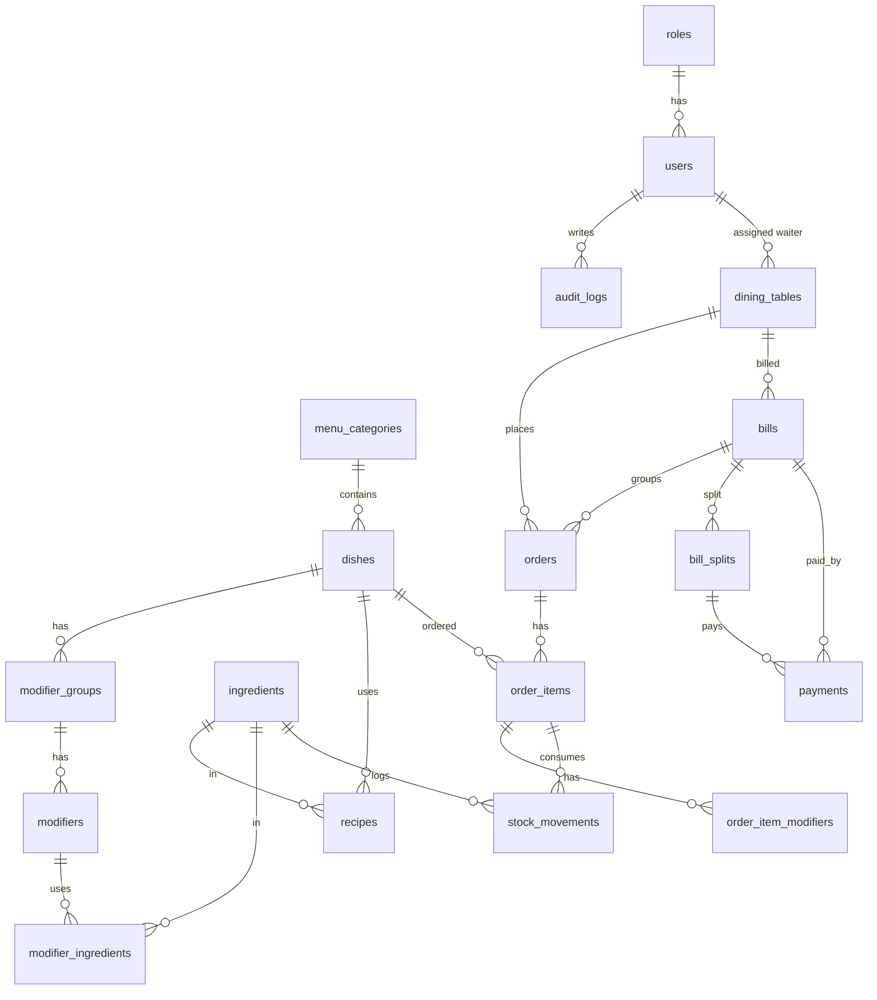
Other tables: `sms_outbox` (simulated SMS), `settings` (service charge, restaurant name).

## Core technical challenge: design
- **Real time.** Services push events to Socket.IO rooms right after the database transaction commits: `kitchen`, `waiters` and `table:<id>`. The kitchen screen reloads all open orders on every (re)connect.
- **Stock deduction.** When the waiter confirms, the recipe and chosen-modifier quantities are deducted inside one transaction with `SELECT ... FOR UPDATE` row locks. Everything is checked first, so either every ingredient is deducted or none is. Two orders competing for the last portion run one after the other, and the second gets `409 INSUFFICIENT_STOCK`. Every movement is logged with its reason.
- **Auto-unavailable.** Availability is computed from live stock each time the menu is read: the scarcest ingredient decides how many portions are possible. After any stock change the server sends `menu:updated` to every screen. Modifiers switch off the same way.

## Assumptions
- Stock is deducted when the waiter confirms (the order reaches the kitchen), not when the customer sends it, so fake orders never touch stock.
- The recipe is copied onto each order item when ordered, so editing a recipe only affects future orders.
- Cancelled before cooking: stock is returned (`adjustment`). Cancelled while cooking or ready: stock stays deducted and the movements become `waste`.
- Each table has one assigned waiter, set by the manager (the "shift" is the current assignment). Other waiters can view but not edit it. A table without a waiter can only be handled by the manager.
- A bill can be created only when no order is pending and every item is served. While a table has an open bill it refuses new orders.
- Splits always add up to the total (rounding cents go to the last person). Partial payment is allowed on a bill without splits. The table becomes Free only when the bill and every split are paid.
- Food cost % uses the dish recipe (without modifiers) and the current ingredient costs. A delivery with a unit cost updates the cost.
- "Daily sales" counts paid bills by the day they were paid, including the service charge.

## Security
bcrypt password hashes · JWT (8 h) with server-side role checks on every request · Zod validation of every input · rate limiting (whole API 600/min per IP, login 30 per 15 min, public orders 20/min) · CORS limited to localhost and the local network · helmet headers · parameterised SQL (Knex) · audit log of sensitive actions (login, failed login, order confirm/reject/move, cancellations, stock, recipes, menu, tables and QR, staff, payments, settings) · secrets only in `.env` (not in Git; see `server/.env.example`).

## Screenshots

Taken from the running app with sample data. A pitch deck with these screens is in [docs/Som-Restaurant-RTO-Pitch.pptx](docs/Som-Restaurant-RTO-Pitch.pptx).

| Customer menu (phone, Somali) | Customer order tracking |
|---|---|
| 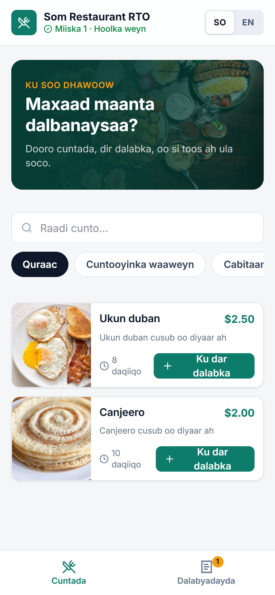 | 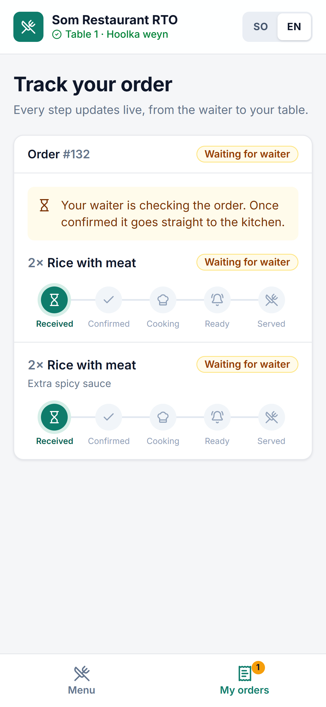 |

**Kitchen display**
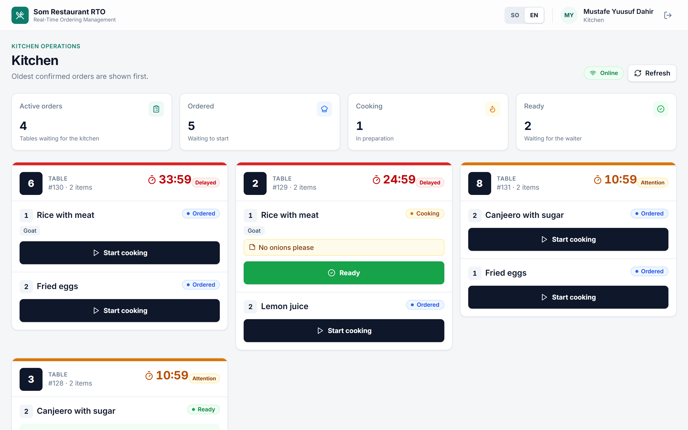

**Waiter floor map**
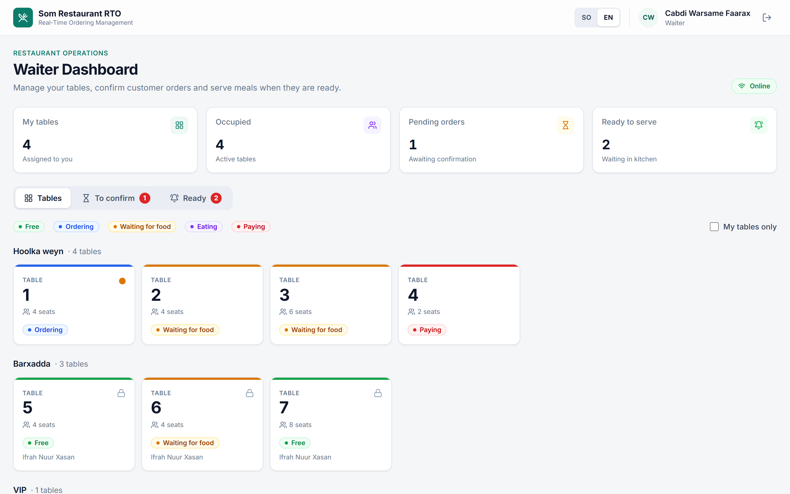

**Cashier: bill, split and payment**
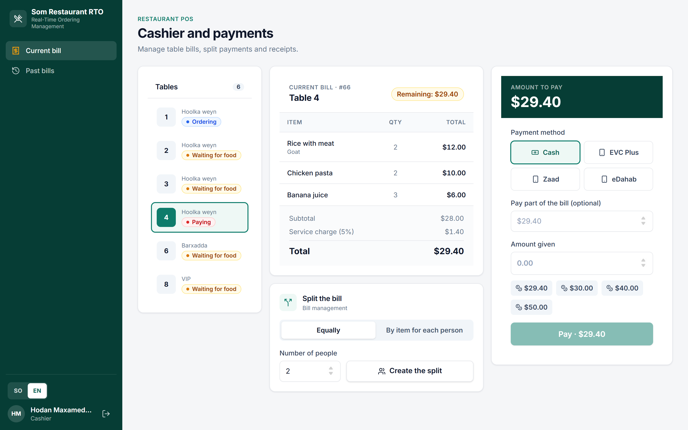

**Reports**
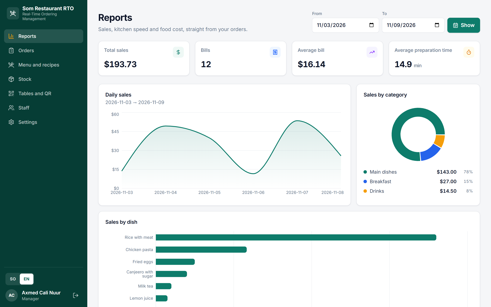

**Stock** · **Menu and recipes** · **Tables and QR** · **Login**
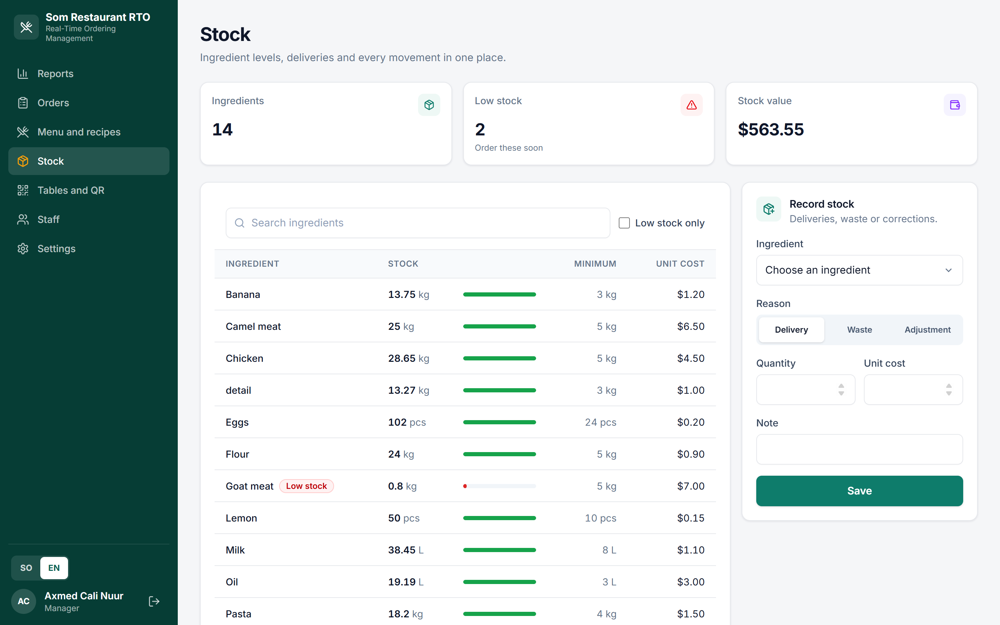
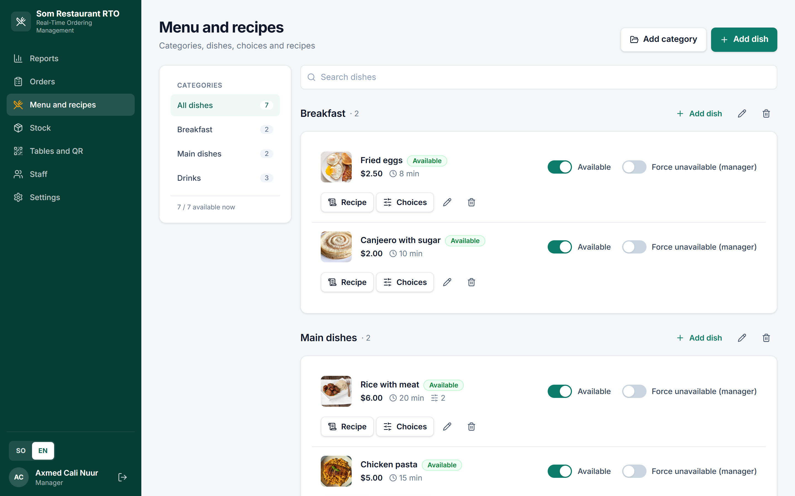
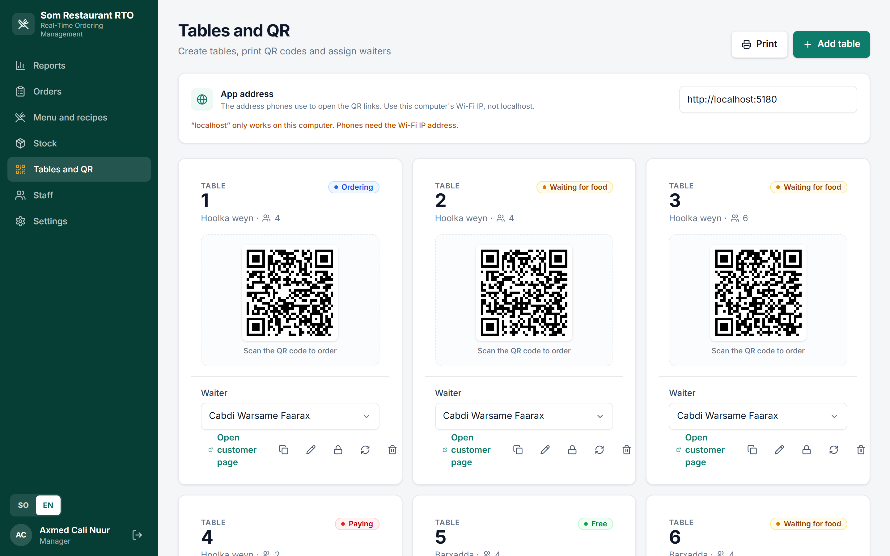
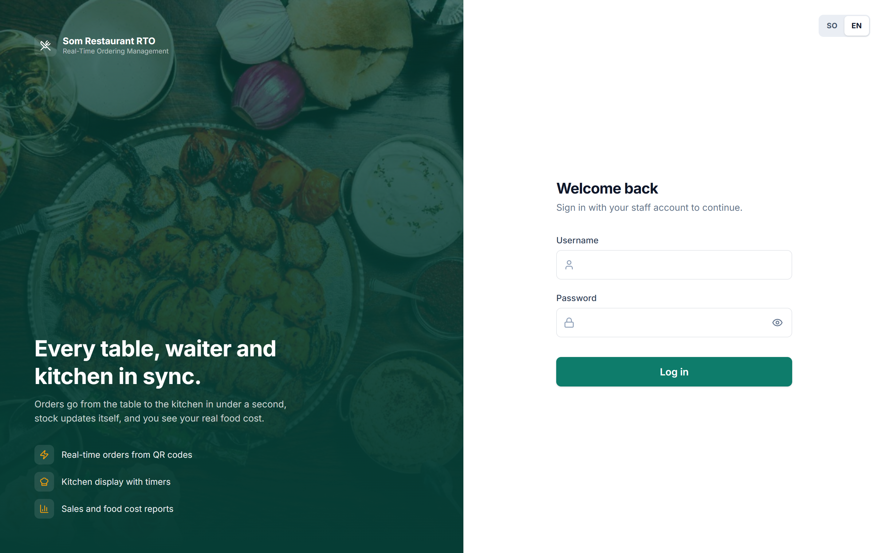

## Known limitations
- Dish photos are set by URL; there is no image upload.
- Low-stock alerts are shown on the Stock page (red rows), not pushed as notifications.
- The waiter assignment is per table, not a timed shift schedule.
- The service is HTTP on the local network (no HTTPS), which is fine for a LAN but not for the internet.
- Payments and SMS are simulated (by design). The receipt is shown on screen and printed through the browser; it is not a PDF file.
